# Thư viện Fixbug – Hệ thống đặt chỗ học tại thư viện trực tuyến (Java + MySQL)

**Nhóm thực hiện: Fix Bug**

Ứng dụng **client – server** viết bằng Java (Socket TCP/UDP, đa luồng, Swing) và lưu dữ liệu trong **MySQL** qua JDBC. Một máy chạy **server** (kèm MySQL), các máy khác trong cùng mạng **LAN** chạy **client** để xem sơ đồ chỗ trống theo thời gian thực, đặt / hủy / check-in chỗ học theo ca.

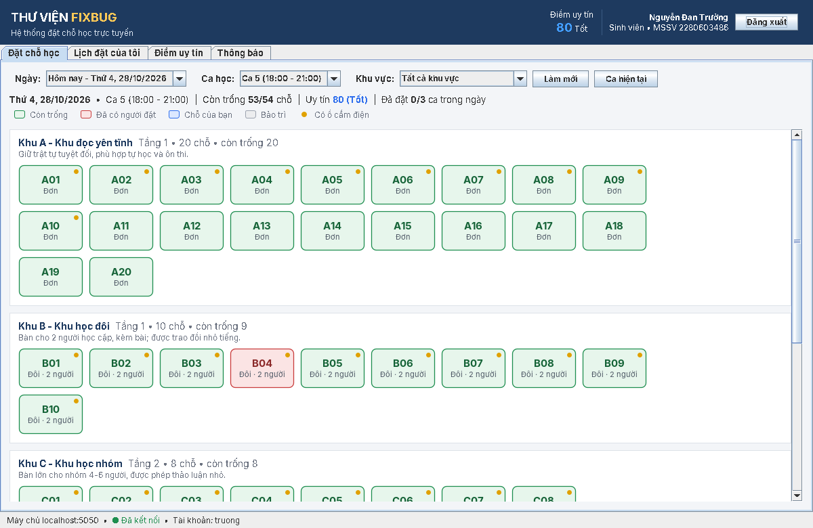

---

## 1. Phân công nhóm Fix Bug

| # | Thành viên | MSSV | Phụ trách | Mã nguồn chính |
|---|---|---|---|---|
| 1 | Nguyễn Văn Thịnh | 2280603107 | **Quản lý nội dung, chỗ ngồi và booking** (kèm thiết kế CSDL, điểm uy tín) | `server/service/ContentService`, `BookingService`, `ReputationService`, `server/db/ReputationDao`, `common/Reputation`, `client/ui/ReputationPanel`, `client/ui/admin/StudentAdminPanel`, `server/db/Schema`, `ZoneDao`, `SeatDao`, `BookingDao`, `AnnouncementDao`, `DataSeeder`, `database/thuvien_fixbug.sql`, `common/*` (Zone, Seat, Booking, SeatMap…), `client/ui/BookingPanel`, `SeatButton`, `MyBookingsPanel`, `AnnouncementsPanel`, `client/ui/admin/ZoneSeatAdminPanel`, `BookingAdminPanel` |
| 2 | Nguyễn Đan Trường | 2280603486 | **Quản lý luồng, phân luồng** | `server/thread/ServerThreadPools`, `NamedThreadFactory`, `EventBroadcaster`, `server/LibraryServer` (vòng accept), `server/ClientHandler`, `server/db/ConnectionPool` (pool kết nối MySQL dùng chung giữa các luồng), `server/db/Database` (transaction, thử lại khi deadlock), `client/net/ServerConnection` (luồng đọc, heartbeat, CompletableFuture), `tools/StressTest` |
| 3 | Chu Nguyễn Gia Bảo | 2380600118 | **Tối ưu quản lý session, mạng LAN** | `server/session/Session`, `SessionManager`, `server/net/DiscoveryResponder`, `client/net/ServerDiscovery`, cơ chế tự kết nối lại + RESUME trong `ServerConnection`, `server/service/UserService` + `server/db/UserDao` (đăng nhập, khóa khi sai mật khẩu), `client/ui/admin/SystemAdminPanel`, `server/ui/ServerFrame`, bộ lọc `ObjectInputFilter` trong `common/Protocol`, **đăng nhập Google**: `server/auth/GoogleAuthService`, `GoogleConfig`, `Json`, `client/net/GoogleSignIn`, `client/ui/GoogleLinkDialog` |

---

## 2. Chức năng

**Sinh viên**
- Đăng ký tài khoản (họ tên, MSSV), đăng nhập.
- Chọn ngày (tối đa 3 ngày tính cả hôm nay, tùy điểm uy tín) + ca học (5 ca/ngày) + khu vực → xem **sơ đồ chỗ ngồi** có màu: trống / đã có người / của tôi / bảo trì, có ổ cắm điện.
- Đặt chỗ, hủy chỗ, **check-in** (từ 15 phút trước đến 15 phút sau giờ bắt đầu ca), **trả chỗ** sớm.
- Sơ đồ **tự cập nhật ngay** khi người khác đặt/hủy (server đẩy sự kiện, không cần bấm làm mới).
- Nhận thông báo tức thì: thông báo mới của thư viện, lượt đặt bị hủy/quá hạn.

**Quy định nghiệp vụ** (kiểm tra ở server): tối đa 3 ca/ngày; mỗi ca chỉ giữ 1 chỗ; thư viện chỉ cho đặt trước tối đa 3 ngày (tính cả hôm nay, cần 100 điểm uy tín – xem bảng dưới); check-in mở từ 15 phút trước giờ bắt đầu ca (chưa đến ca thì không check-in được); không check-in đúng giờ → hệ thống tự hủy để nhường chỗ; hết ca → tự hoàn thành.

**Đặt lẻ / ngồi ghép** – tận dụng bàn nhiều chỗ khi khu chỗ đơn đã kín:
- Bình thường bàn đôi, bàn nhóm, phòng riêng được đặt **cả bàn** (một lượt giữ cả bàn).
- Khi **mọi chỗ đơn (khu A) trong ca đã có người**, hệ thống **mở một bàn** cho đặt lẻ từng chỗ (ô màu vàng): sinh viên đặt 1 chỗ và ngồi ghép với người khác, hoặc vẫn có thể đặt cả bàn nếu bàn chưa ai ngồi.
- **Bàn đó đủ người thì mới mở bàn tiếp theo**, theo thứ tự: bàn đôi B01 → B10, rồi bàn nhóm (khu C), rồi phòng riêng (khu E). Máy tính (khu D) là chỗ 1 người nên không áp dụng.
- Bàn đã có người ngồi ghép mà còn chỗ thì vẫn nhận thêm cho đủ bàn (kể cả khi khu đơn vừa có người hủy), và không đặt cả bàn được nữa.
- Mỗi người ngồi ghép là một lượt đặt riêng: mã riêng, check-in / hủy / điểm uy tín tính riêng, hiển thị dạng `B01 (ghép #1)`. Sinh viên không thấy tên người ngồi cùng; quản trị viên thấy đủ danh sách.
- Chống đặt trùng khi nhiều người cùng bấm: khóa duy nhất `uq_seat_place_live` theo từng vị trí, khóa dòng chỗ ngồi (`SELECT … FOR UPDATE`) và việc chọn "bàn nào được mở" chạy tuần tự trên server – 4 người tranh 2 chỗ thì đúng 2 người được.

**Điểm uy tín** – hạn chế đặt chỗ rồi không đến. Mỗi tài khoản sinh viên mới bắt đầu với **80 điểm** (tối đa 100):

| Hành vi | Điểm |
|---|---|
| Đặt chỗ nhưng không đến / không check-in | −20 |
| Hủy lượt đặt dưới 60 phút trước giờ bắt đầu ca | −5 |
| Check-in đúng hẹn | +5 (tối đa 100) |

| Điểm | Mức | Quyền đặt chỗ |
|---|---|---|
| 100 | Xuất sắc | 3 ca/ngày, đặt trước 3 ngày (hôm nay, ngày mai, ngày kia) |
| 80–99 (khởi đầu 80) | Tốt | 3 ca/ngày, đặt trước 2 ngày (hôm nay, ngày mai) |
| 50–79 | Hạn chế | 1 ca/ngày, đặt trước 2 ngày |
| dưới 50 | Tạm khóa | không được tự đặt trong 7 ngày, hết hạn tự mở lại ở mức 50 điểm |

Sinh viên xem điểm, mức và lịch sử cộng/trừ ở tab **Điểm uy tín** (điểm cũng hiện ở góc trên). Lượt đặt tại quầy và lượt bị quản trị viên hủy / chỗ bảo trì **không** làm trừ điểm.

**Quản trị viên** (đăng nhập `admin`)
- **Đặt chỗ không giới hạn**: không bị giới hạn 3 ca/ngày hay 1 chỗ/ca, đặt được cả ca đang diễn ra (vẫn theo quy định thư viện: đặt trước tối đa 3 ngày).
- **Đặt hộ sinh viên không có tài khoản (đặt trực tiếp tại quầy)**: bấm vào chỗ trống trên sơ đồ → chọn "Đặt hộ sinh viên" → ghi **họ tên, MSSV, số điện thoại, ghi chú**; tích "Sinh viên đang có mặt" để check-in luôn. Thông tin hiện khi rê chuột / bấm vào chỗ và trong tab *QT: Quản lý đặt chỗ* (cột Hình thức = "Tại quầy").
- **Check-in hộ / xác nhận trả chỗ** cho bất kỳ lượt đặt nào (từ sơ đồ hoặc tab *QT: Quản lý đặt chỗ*).
- **Sinh viên & uy tín**: danh sách sinh viên xếp theo điểm từ thấp đến cao, số lần không đến, ai đang bị khóa; **cộng / trừ điểm** (bắt buộc ghi lý do), **khôi phục 80 điểm** – về mức khởi đầu, mở khóa ngay, xem lịch sử điểm của từng người.
- Quản lý **khu vực** và **chỗ ngồi**: thêm / sửa / xóa, thêm nhanh nhiều chỗ, đưa chỗ vào **bảo trì** (tự hủy lượt đặt liên quan và báo cho sinh viên).
- Đăng / xóa **thông báo** (đẩy ngay tới mọi người đang trực tuyến).
- Xem / lọc / tìm kiếm mọi lượt đặt, hủy lượt đặt kèm lý do.
- Xem **phiên đăng nhập** (IP, trạng thái, hoạt động cuối) và **ngắt phiên**; xem thống kê luồng, pool kết nối MySQL, đặt chỗ.

**Máy chủ**: cửa sổ giám sát gồm danh sách phiên, thống kê pool luồng và pool kết nối MySQL, nhật ký có ghi **tên luồng** đang xử lý, nút kiểm tra kết nối MySQL.

---

## 3. Cơ sở dữ liệu MySQL

Database `thuvien_fixbug` (utf8mb4) gồm 5 bảng:

```
users (username PK, full_name, student_id UNIQUE, role, salt, password_hash, created_at,
       reputation, locked_until)                       reputation_log (id PK, username FK → users,
                                                                       delta, score_after, reason, booking_id, created_at)
   │ 1
   │                                      zones (id PK, name, floor, description)
   │ n                                       │ 1
bookings (id PK AUTO_INCREMENT,              │ n   ON DELETE CASCADE
          username FK → users,            seats (id PK, zone_id FK → zones, type, capacity,
          full_name, student_id,                 has_outlet, active, note)
          seat_id, zone_id, zone_name,
          booking_date, slot, status, live, owner_live,
          walk_in, phone, guest_note,
          created_at, checked_in_at, finished_at, note)
          UNIQUE uq_seat_live  (seat_id, booking_date, slot, live)
          UNIQUE uq_owner_live (username, booking_date, slot, owner_live)

announcements (id PK AUTO_INCREMENT, title, content, author, created_at)
```

- Mật khẩu **không lưu dạng rõ**: băm PBKDF2-SHA256 + salt ngẫu nhiên.
- Cột **`live`** = 1 khi lượt đặt còn hiệu lực (ACTIVE / CHECKED_IN), = NULL khi đã kết thúc. MySQL cho phép nhiều NULL trong UNIQUE KEY, nên `uq_seat_place_live (seat_id, booking_date, slot, place, live)` bảo đảm **ngay trong CSDL**: mỗi vị trí của một chỗ trong một ca chỉ có tối đa 1 lượt còn hiệu lực. Lượt đã hủy vẫn được giữ lại làm lịch sử.
- Cột **`place`** = 0 khi đặt cả chỗ / cả bàn; = 1, 2, … khi đặt lẻ từng chỗ (ngồi ghép).
- Cột **`owner_live`** = 1 chỉ với lượt **sinh viên tự đặt** còn hiệu lực → `uq_owner_live` bảo đảm mỗi sinh viên giữ 1 chỗ mỗi ca. Lượt do quản trị viên đặt có `owner_live = NULL` nên không bị giới hạn.
- **Đăng nhập Google**: cột `users.google_sub` (mã cố định của tài khoản Google, UNIQUE) và `users.email`.
- **Điểm uy tín**: cột `users.reputation` (mặc định 80) và `users.locked_until` (ngày hết khóa); mỗi lần cộng/trừ ghi một dòng vào `reputation_log` (lý do, mã lượt đặt) để tra cứu lại.
- Lượt **đặt tại quầy** (`walk_in = TRUE`): `username` là quản trị viên đã tạo, `full_name` / `student_id` / `phone` / `guest_note` là thông tin sinh viên không có tài khoản.
- CSDL tạo từ phiên bản trước được **tự nâng cấp** khi chạy server (thêm cột mới, đổi khóa; sinh viên chưa từng được cộng/trừ điểm đưa về mức khởi đầu 80; thêm *Khu học đôi* nếu chưa có bàn đôi và đổi mã khu thành A đơn – B đôi – C nhóm – D máy tính – E phòng riêng, mã chỗ trên lượt đặt cũ đổi theo), dữ liệu cũ giữ nguyên. Các bản cập nhật dữ liệu ghi dấu vào bảng `app_meta` để chỉ chạy một lần (admin xóa khu đôi thì lần sau không bị thêm lại).
- Mã hiển thị `BK00012` = cột `id` 12 của bảng bookings; `TB0003` = thông báo id 3.
- Tất cả câu lệnh dùng **PreparedStatement** (chống SQL injection); mọi thao tác ghi chạy trong **transaction** (lỗi giữa chừng → rollback).
- Server **tự tạo** database, bảng và dữ liệu mẫu khi chạy lần đầu. File `database/thuvien_fixbug.sql` có cùng nội dung để import bằng phpMyAdmin / MySQL Workbench (dùng cho báo cáo hoặc khi tài khoản MySQL không có quyền tạo database).

---

## 4. Kiến trúc

```
 ┌──────────── Máy sinh viên (LAN) ────────────┐            ┌──────────────────────── Máy chủ ────────────────────────┐
 │  Swing UI (EDT)                              │            │  accept-loop ──► pool "client-handler-N" (1 luồng/client)│
 │     ▲ invokeLater                            │  TCP 5050  │        │                                                 │
 │  ServerConnection                            │◄──────────►│        ▼                                                 │
 │   • luồng client-reader  (phản hồi + push)   │  Object    │   RequestHandler ─► UserService / ContentService /       │
 │   • luồng client-heartbeat (PING, reconnect) │  Stream    │                      BookingService                      │
 │   • requestId ↔ CompletableFuture            │            │                         │ DAO + transaction              │
 │  ServerDiscovery ── UDP broadcast ──────────►│  UDP 5051  │   lan-discovery         ▼                                │
 └──────────────────────────────────────────────┘            │                   ConnectionPool ══ JDBC ══► MySQL 3306  │
                                                             │   SessionManager  ◄── luồng "scheduler" (dọn phiên,     │
                                                             │                         tự hủy lượt không check-in)      │
                                                             │   EventBroadcaster ── luồng "event-broadcaster" ► push   │
                                                             └──────────────────────────────────────────────────────────┘
```

| Gói | Nội dung |
|---|---|
| `library.common` | Lớp dùng chung client/server: `Message` (gói tin), `Command`, `EventType`, model (Zone, Seat, Booking…), `TimeSlot`, `Protocol` |
| `library.server` | `ServerMain`, `LibraryServer`, `ClientHandler`, `RequestHandler`, `Log` |
| `library.server.db` | Kết nối MySQL: `DbConfig` (đọc db.properties), `ConnectionPool`, `Database` (query / transaction), `Schema`, các DAO, `DataSeeder` |
| `library.server.service` | Nghiệp vụ người dùng, nội dung, đặt chỗ; băm mật khẩu |
| `library.server.thread` | Pool luồng, đặt tên luồng, phát sự kiện bất đồng bộ |
| `library.server.session` | Phiên đăng nhập, token, hết hạn, kết nối lại |
| `library.server.net` | Trả lời tìm server trong LAN (UDP) |
| `library.client.net` | Kết nối TCP, tìm server LAN |
| `library.client.ui` | Giao diện Swing (đăng nhập, đặt chỗ, lịch của tôi, thông báo, quản trị) |
| `library.tools` | `StressTest` – kiểm thử đặt chỗ đồng thời |

### Phân luồng (thành viên 2)
| Luồng / tài nguyên | Nhiệm vụ |
|---|---|
| `accept-loop` | Chỉ nhận kết nối mới rồi giao cho pool → không bao giờ bị nghẽn |
| `client-handler-N` | `ThreadPoolExecutor` + `SynchronousQueue`: mỗi client 1 luồng, tối đa `--max-clients`, luồng rảnh 60 s tự giải phóng, vượt giới hạn → trả lời "máy chủ quá tải" |
| Pool kết nối MySQL | `ArrayBlockingQueue` các kết nối JDBC dùng chung: luồng mượn → dùng → trả trong `finally`; tối đa `db.poolSize` kết nối, hết thì luồng **chờ** (tối đa 10 s) thay vì mở thêm; kết nối chết được kiểm tra `isValid` và thay mới |
| `scheduler-N` | Tác vụ nền: dọn phiên hết hạn (30 s, chỉ duyệt bộ nhớ); **hẹn giờ theo mốc ca học** để tự hủy / hoàn thành lượt đặt (xem bên dưới); mở khóa điểm uy tín 1 lần lúc 0 giờ |
| `event-broadcaster` | Đẩy sự kiện tới các client → người đặt chỗ nhận phản hồi ngay, không chờ gửi xong cho người khác |
| `lan-discovery` | Trả lời gói UDP tìm server |

**Tiết kiệm tài nguyên – hẹn giờ theo mốc thay vì quét liên tục:** lượt đặt không cần luồng hay bộ đếm giờ riêng. Vì lịch ca cố định, mọi lượt đặt chỉ đổi trạng thái tại **10 mốc mỗi ngày**: 15 phút sau giờ bắt đầu mỗi ca (chưa check-in → tự hủy, trừ điểm uy tín) và giờ kết thúc mỗi ca (→ hoàn thành). Luồng `scheduler` tính mốc kế tiếp (`BookingService.nextDeadline`), "ngủ" tới đúng mốc đó rồi xử lý **tất cả** lượt đến hạn bằng một truy vấn (`ServerThreadPools.scheduleAtMilestones`). Khi khởi động, server chạy bù một lần cho các lượt quá hạn trong lúc server tắt.

| | Trước | Sau |
|---|---|---|
| Kiểm tra lượt đặt quá hạn / hết ca | quét CSDL 30 s/lần = 2.880 lần/ngày, trễ tới 30 s | 10 lần/ngày, đúng mốc (trễ ~1 s) |
| Mở khóa điểm uy tín | 5 phút/lần = 288 lần/ngày | 1 lần lúc 0 giờ |
| Cửa sổ giám sát server | truy vấn CSDL + dò card mạng mỗi giây trên luồng giao diện | thống kê 5 s/lần trên luồng nền; thu nhỏ / ẩn cửa sổ thì dừng cập nhật |
| PING của client | 15 s/lần kể cả khi đang thao tác | chỉ gửi khi 15 s không có yêu cầu nào khác |

Tab *Phiên & hệ thống* / cửa sổ server hiển thị dòng **"Hẹn giờ: …"** với thời điểm chạy kế tiếp; nhật ký server ghi mỗi lần chạy (ví dụ `Hẹn giờ: đã kiểm tra lượt đặt quá giờ check-in / hết ca - lần tiếp theo lúc 09:45:01`).

**Chống đặt trùng chỗ khi nhiều luồng cùng đặt:** mỗi lượt đặt chạy trong một transaction (khóa dòng người dùng bằng `SELECT … FOR UPDATE`, kiểm tra giới hạn, rồi `INSERT`). Nếu nhiều luồng cùng vượt qua bước kiểm tra, `UNIQUE KEY uq_seat_live` của MySQL chỉ cho **một** lệnh INSERT thành công, các lệnh còn lại nhận lỗi trùng khóa và được báo "chỗ vừa được người khác đặt". MySQL báo deadlock → tự thử lại transaction (tối đa 3 lần).

### Quản lý session (thành viên 3)
- Token 256-bit (`SecureRandom`), tra cứu O(1) bằng `ConcurrentHashMap` theo token và theo tài khoản.
- **Mỗi tài khoản 1 phiên**: đăng nhập ở máy khác → máy cũ bị đăng xuất và được báo rõ lý do.
- Hết hạn sau 30 phút **không thao tác** (gói PING giữ kết nối không tính là thao tác).
- **Rớt mạng không mất phiên**: server giữ phiên 120 giây; client tự kết nối lại mỗi 3 giây và gửi `RESUME_SESSION` bằng token → tiếp tục làm việc không cần đăng nhập lại.
- Phát hiện kết nối "chết" (half-open): client PING khi 15 s không gửi gì (đang thao tác thì không cần PING), server đóng kết nối nếu 45 s không nhận được gì.
- Quản trị viên chỉ thấy **mã phiên công khai** (S0001…), không bao giờ thấy token → không thể mạo danh.
- Sai mật khẩu 5 lần → khóa đăng nhập tài khoản đó 60 giây.

### Mạng LAN
- Server lắng nghe trên mọi card mạng; khi khởi động in ra các địa chỉ LAN (VD `192.168.1.10:5050`).
- Client bấm **"Tìm trong LAN"** → gửi UDP broadcast tới cổng 5051 → server trả lời tên + cổng → tự điền địa chỉ.
- Client **không** kết nối thẳng MySQL; chỉ máy chủ giữ tài khoản CSDL → MySQL không cần mở ra mạng LAN.
- Dữ liệu nhận qua mạng được lọc bằng `ObjectInputFilter` (chỉ cho phép lớp của ứng dụng + JDK) để chặn tấn công deserialization.

---

## 5. Cách chạy

**Yêu cầu:** JDK **11 trở lên**; **MySQL 8.x** (hoặc MySQL 5.7 / MariaDB 10.3+ của XAMPP) trên máy chạy server.

### Bước 1 – Bật MySQL
- **XAMPP** (dễ nhất): mở XAMPP Control Panel → **Start** dòng *MySQL*. Tài khoản mặc định `root`, mật khẩu trống → không cần sửa gì.
- **MySQL Installer / MySQL Server**: dịch vụ MySQL80 tự chạy. Mở file **`db.properties`** ở thư mục dự án và điền mật khẩu root đã đặt khi cài vào dòng `db.password=`.

Không cần tự tạo database: lần đầu chạy, server tự tạo database `thuvien_fixbug`, các bảng và dữ liệu mẫu. (Hoặc import `database/thuvien_fixbug.sql` bằng phpMyAdmin → tab *Import*.)

### Bước 2 – Chạy bằng Apache NetBeans
1. **File → Open Project** → chọn thư mục `LibraryBooking` (project Maven). Lần đầu NetBeans tự tải driver **MySQL Connector/J** (cần Internet).
2. Chuột phải `library.server.ServerMain` → **Run File**. Nhật ký phải có dòng *"Đã kết nối MySQL …"*.
3. Chuột phải `library.client.ClientMain` → **Run File** (chạy nhiều lần = nhiều client).

NetBeans chạy với thư mục làm việc là thư mục dự án, nên server đọc `db.properties` ở đó.

### Hoặc chạy bằng file .bat (Windows)
1. Nhấp đúp **`build.bat`** – lần đầu tự tải `mysql-connector-j-8.4.0.jar` vào `lib/` (cần Internet), biên dịch và tạo `dist/`.
2. Nhấp đúp **`run-server.bat`**, sau đó **`run-client.bat`**.

Linux/macOS: `./build.sh`, `./run-server.sh`, `./run-client.sh`.

### Chạy qua mạng LAN (nhiều máy)
1. Máy chủ (có MySQL): chạy server. Lần đầu Windows hỏi tường lửa → chọn **Allow** cho mạng **Private**. Ghi lại địa chỉ hiển thị ở đầu cửa sổ (VD `192.168.1.10`).
2. Máy khác: chỉ cần **`dist/FixBug-Client.jar`** và Java (không cần MySQL), nhấp đúp file jar.
3. Ở màn hình đăng nhập bấm **"Tìm trong LAN"** để tự tìm máy chủ, hoặc nhập IP thủ công, cổng `5050`.

### Tài khoản mẫu
| Tài khoản | Mật khẩu | Vai trò |
|---|---|---|
| `admin` | `admin123` | Quản trị viên |
| `thinh` | `123456` | Sinh viên – Nguyễn Văn Thịnh |
| `truong` | `123456` | Sinh viên – Nguyễn Đan Trường |
| `bao` | `123456` | Sinh viên – Chu Nguyễn Gia Bảo |

### Khu vực & chỗ ngồi mẫu
| Khu | Tên | Chỗ |
|---|---|---|
| A | Khu đọc yên tĩnh (tầng 1) | A01–A20: chỗ đơn, A01–A10 có ổ cắm |
| B | Khu học đôi (tầng 1) | B01–B10: **bàn đôi 2 người**, có ổ cắm |
| C | Khu học nhóm (tầng 2) | C01–C04: bàn 6 người, C05–C08: bàn 4 người |
| D | Khu máy tính (tầng 2) | D01–D12: máy tính |
| E | Phòng học riêng (tầng 3) | E01–E04: phòng 8 người |

Sơ đồ chỗ, ô chọn khu vực và bảng quản trị đều xếp các khu **theo tầng, rồi theo mã khu**, nên khu đôi B (tầng 1) nằm ngay dưới khu chỗ đơn A. Muốn đổi thứ tự thì quản trị viên sửa số tầng của khu.

Muốn quay về dữ liệu mẫu: trong phpMyAdmin xóa (Drop) database `thuvien_fixbug` rồi chạy lại server.

Tên nhóm / tên thư viện hiển thị được khai báo một chỗ duy nhất: hằng `GROUP_NAME` trong `src/main/java/library/common/Protocol.java`.

### Đăng nhập bằng Google (tùy chọn)
Màn hình đăng nhập có nút **"Đăng nhập bằng Google"**. Nút chỉ hoạt động sau khi server được cấu hình:

1. Vào <https://console.cloud.google.com>, tạo (hoặc chọn) một project.
2. **APIs & Services → OAuth consent screen**: chọn *External*, điền tên ứng dụng và email hỗ trợ. Ở mục **Test users**, thêm Gmail của những người được phép đăng nhập (khi ứng dụng còn ở chế độ *Testing*, chỉ các email này đăng nhập được).
3. **APIs & Services → Credentials → Create credentials → OAuth client ID**, chọn *Application type* = **Desktop app**.
4. Chạy server một lần để server tự tạo file **`google.properties`** cạnh `db.properties`. Dán *Client ID* và *Client secret* vào file đó rồi chạy lại server. Log sẽ báo *"Đăng nhập bằng Google: ĐÃ BẬT"*.
   - Có thể đặt `google.allowedDomain=hutech.edu.vn` (ví dụ) để chỉ cho email trường đăng nhập.
   - `google.properties` chứa khóa bí mật nên đã có trong `.gitignore`, **không đưa lên GitHub**.

Cách hoạt động (OAuth 2.0 cho ứng dụng máy tính, luồng *loopback* + **PKCE**):
1. Client hỏi server Client ID, mở một cổng tạm trên `127.0.0.1` rồi mở trình duyệt tới trang đăng nhập Google.
2. Người dùng chọn tài khoản. Google chuyển trình duyệt về `http://127.0.0.1:<cổng>/?code=…` và client nhận được **mã xác thực**.
3. Client gửi mã + `code_verifier` lên server. **Server** (giữ *Client secret*, client không bao giờ biết) đổi mã lấy *ID token* tại Google, rồi kiểm tra nơi phát hành (`iss`), ứng dụng nhận (`aud`), hạn dùng (`exp`) và email đã xác minh.
4. Tài khoản Google đã liên kết thì đăng nhập luôn. Lần đầu, ứng dụng hỏi **tạo tài khoản sinh viên mới** (điền MSSV) hoặc **liên kết với tài khoản đã có** (nhập mật khẩu tài khoản đó). Liên kết lưu theo mã cố định của tài khoản Google (`users.google_sub`), nên đổi email Gmail vẫn đăng nhập được.

Máy chạy **server** cần Internet (để gọi Google). Máy **client** cần trình duyệt.

### Lỗi thường gặp khi kết nối MySQL
| Thông báo | Cách xử lý |
|---|---|
| *Không kết nối được MySQL tại localhost:3306* | MySQL chưa bật → XAMPP bấm Start MySQL (hoặc bật dịch vụ MySQL80). Kiểm tra `db.port` nếu đã đổi cổng. |
| *MySQL từ chối đăng nhập với tài khoản 'root'* | Sai mật khẩu → sửa `db.password` trong `db.properties`. |
| *Thiếu thư viện MySQL Connector/J* | NetBeans: chuột phải project → **Build with Dependencies** (cần Internet). File .bat: chạy `build.bat`, hoặc tải jar thủ công vào `lib/` (xem `lib/README.txt`). |
| *Chưa có database … và không tự tạo được* | Tài khoản MySQL không có quyền CREATE → import `database/thuvien_fixbug.sql`. |

### Tham số server
```
java -jar dist/FixBug-Server.jar [tùy chọn]
  --port N              Cổng TCP (mặc định 5050)
  --discovery-port N    Cổng UDP tìm server (mặc định 5051)
  --no-discovery        Tắt tìm server trong LAN
  --max-clients N       Số client tối đa đồng thời (mặc định 100)
  --session-timeout N   Phút không thao tác thì hết phiên (mặc định 30)
  --reconnect-grace N   Giây giữ phiên khi client rớt mạng (mặc định 120)
  --db-config FILE      File cấu hình MySQL (mặc định ./db.properties)
  --name TÊN            Tên server hiển thị khi client tìm trong LAN (mặc định: Fixbug)
  --nogui               Chạy dòng lệnh (lệnh: stats, sessions, kick S0001, stop)
```

---

## 6. Kịch bản demo gợi ý

1. **Thời gian thực:** mở 2 client (thinh và truong) cùng ngày/ca. Thịnh đặt A05 → ô A05 trên máy Trường chuyển đỏ ngay lập tức. Mở phpMyAdmin → bảng `bookings` thấy dòng mới với `live = 1`.
2. **Tranh chấp chỗ (phân luồng + CSDL):** chạy server rồi `run-stress-test.bat` – 20 client cùng lúc đặt **một** chỗ, kết quả đúng 1 thành công, 19 bị từ chối. Ví dụ kết quả (thời gian mỗi lần chạy sẽ khác):
   ```
   [3] 20 luồng sẵn sàng - BẮT ĐẦU!
       test07  thất bại    17.2 ms  Rất tiếc, chỗ A01 vừa được người khác đặt...
       ...
       test03  THÀNH CÔNG  68.2 ms  Đặt chỗ thành công! Mã đặt chỗ: BK00001
   [4] KẾT QUẢ: 1/20 yêu cầu thành công  →  ĐÚNG (không đặt trùng chỗ)
   ```
   Thử đặt `db.poolSize=3` trong `db.properties`: kết quả vẫn đúng, tab *QT: Phiên & hệ thống* cho thấy số lượt luồng phải chờ kết nối.
3. **Session:** đăng nhập `thinh` ở máy thứ hai → máy thứ nhất bị đăng xuất kèm thông báo IP. Admin vào tab *QT: Phiên & hệ thống* → *Ngắt phiên*.
4. **Rớt mạng:** rút dây mạng / tắt Wi-Fi client vài giây → thanh vàng "Đang kết nối lại" → cắm lại → "Đã kết nối lại, phiên được giữ nguyên".
5. **Hết phiên:** chạy `run-server.bat --session-timeout 1`, để client không thao tác ~1,5 phút → tự về màn hình đăng nhập.
6. **Đặt tại quầy:** đăng nhập `admin`, bấm một chỗ trống → "Đặt hộ sinh viên không có tài khoản" → nhập họ tên, MSSV, SĐT, ghi chú. Chỗ chuyển đỏ trên mọi máy; tab *QT: Quản lý đặt chỗ* hiện lượt "Tại quầy" kèm thông tin; khi sinh viên đến, bấm *Check-in*.
7. **Điểm uy tín:** đặt một chỗ ca sắp tới rồi không check-in → sau 15 phút kể từ giờ bắt đầu ca, lượt bị hủy và sinh viên nhận thông báo "−20 điểm uy tín". Tab *Điểm uy tín* hiện lịch sử; admin xem tab *QT: Sinh viên & uy tín* để thấy ai hay không đến và khôi phục điểm khi cần. Tài khoản mới có 80 điểm nên chỉ thấy được hôm nay và ngày mai; check-in đúng hẹn 4 lần (+5 mỗi lần) đạt 100 điểm thì đặt được thêm ngày kia.
8. **Nội dung:** admin đưa chỗ đã có người đặt vào bảo trì → sinh viên nhận thông báo lượt đặt bị hủy (bảng `bookings`: `status = CANCELLED`, `live = NULL`); admin đăng thông báo → mọi client hiện thông báo mới.

---

## 7. Các lỗi kinh điển đã được xử lý trong mã nguồn

| Lỗi | Cách xử lý | Vị trí |
|---|---|---|
| Hai người đặt trùng một chỗ (race condition) | Transaction + `UNIQUE KEY uq_seat_live` trong MySQL làm chốt chặn cuối | `BookingService.book`, `Schema` |
| SQL injection | Chỉ dùng `PreparedStatement` với tham số `?` | `server/db/*Dao` |
| Lỗi giữa chừng để lại dữ liệu dở dang | Transaction: commit khi xong, rollback khi lỗi (kể cả lỗi nghiệp vụ) | `Database.tx` |
| Mở kết nối CSDL mỗi yêu cầu (chậm), hoặc quá nhiều kết nối làm sập MySQL | Pool kết nối có giới hạn, luồng chờ khi hết kết nối | `ConnectionPool` |
| Kết nối MySQL "chết" sau thời gian rảnh (wait_timeout) | Kiểm tra `isValid` trước khi giao, tự thay kết nối hỏng | `ConnectionPool.borrow` |
| Deadlock InnoDB khi nhiều transaction đồng thời | Tự thử lại transaction (tối đa 3 lần) | `Database.tx` |
| Lưu mật khẩu dạng rõ | PBKDF2-SHA256 + salt, so sánh thời gian hằng | `PasswordHasher` |
| Client nhận dữ liệu cũ khi gửi lại cùng đối tượng | Gọi `ObjectOutputStream.reset()` sau mỗi lần gửi | `ClientHandler.send`, `ServerConnection.send` |
| Treo khi tạo stream (cả hai bên chờ header) | Tạo `ObjectOutputStream` và `flush()` trước khi tạo `ObjectInputStream` | `ClientHandler.run`, `ServerConnection.connect` |
| Giao diện đơ khi chờ mạng | Gửi bất đồng bộ (`CompletableFuture`, `SwingWorker`), cập nhật UI qua `invokeLater` | `UiKit.call`, `LoginFrame` |
| Ghi socket đồng thời từ 2 luồng làm hỏng stream | `send()` được `synchronized` | `ClientHandler` |
| Tác vụ định kỳ "chết" âm thầm khi gặp lỗi | Bọc bằng `ServerThreadPools.safe(...)` | `ServerThreadPools` |
| Kết nối treo (half-open) giữ phiên mãi | Heartbeat 15 s + `SO_TIMEOUT` 45 s, RESUME đóng kết nối cũ | `Protocol`, `SessionManager.resume` |
| Server quá tải nhận vô hạn kết nối | Pool có giới hạn, từ chối lịch sự kèm thông báo | `LibraryServer.acceptLoop` |
| Dấu tiếng Việt bị lỗi | Biên dịch `-encoding UTF-8`, CSDL `utf8mb4`, chừa lề trên cho chữ có dấu chồng | `build.bat`, `Schema`, `UiKit.label` |

---

## 8. Cấu trúc thư mục

```
LibraryBooking/
├── src/main/java/library/
│   ├── common/          Lớp dùng chung (Message, Command, Zone, Seat, Booking, TimeSlot…)
│   ├── server/          Máy chủ (+ db/, service/, thread/, session/, net/, ui/, auth/)
│   ├── client/          Ứng dụng người dùng (net/, ui/, ui/admin/)
│   └── tools/           StressTest
├── database/            thuvien_fixbug.sql (tạo bảng + dữ liệu mẫu)
├── db.properties        Cấu hình kết nối MySQL
├── lib/                 Nơi chứa mysql-connector-j-8.4.0.jar (build.bat tự tải)
├── dist/                FixBug-Server.jar, FixBug-Client.jar
├── docs/screenshots/    Ảnh chụp màn hình
├── build.bat  run-server.bat  run-client.bat  run-stress-test.bat
├── build.sh   run-server.sh   run-client.sh
└── pom.xml              Project Maven (NetBeans), khai báo driver MySQL
```

---

## 9. Ảnh chụp màn hình

| | |
|---|---|
| Đăng nhập, tìm server LAN 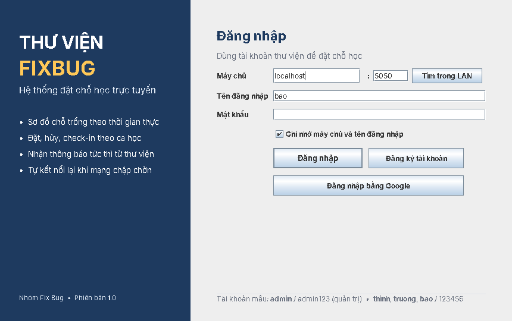 | Thông báo tức thì (bị hủy lượt, thông báo mới) 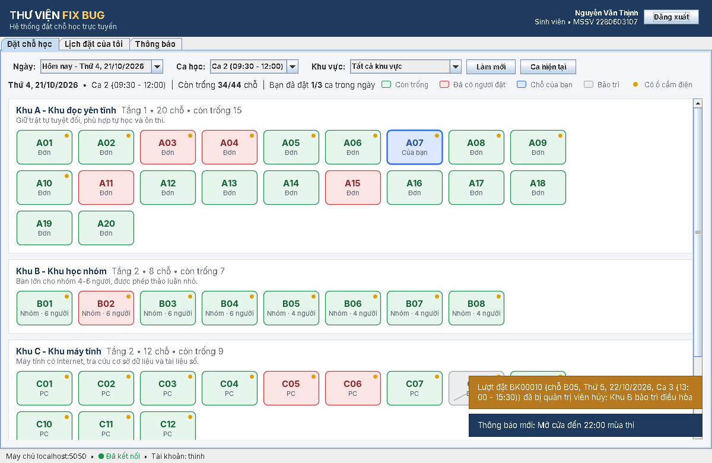 |
| Lịch đặt của tôi 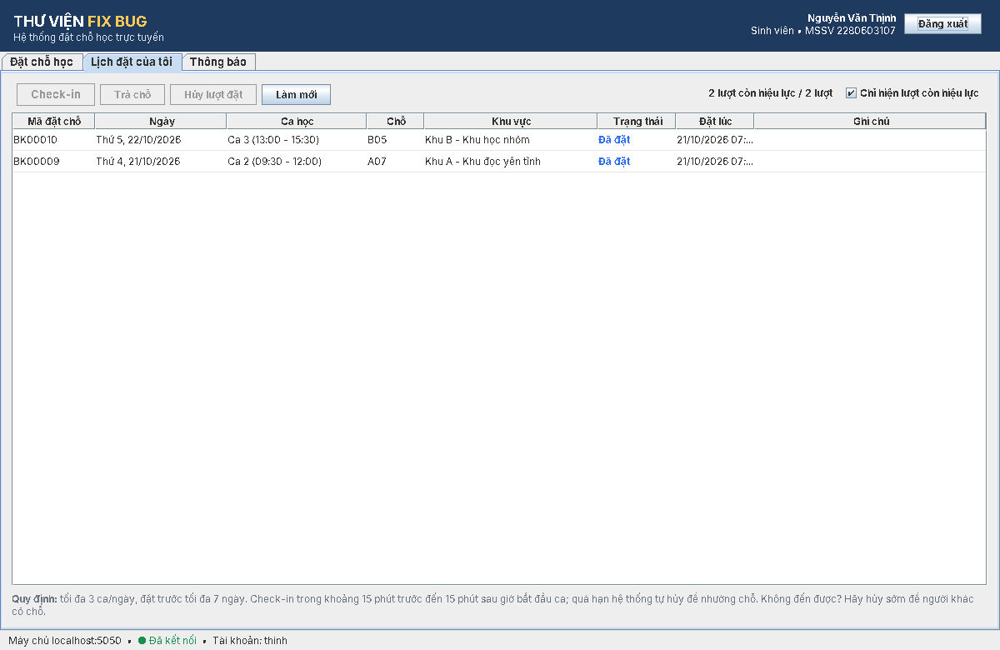 | Quản trị khu vực & chỗ ngồi 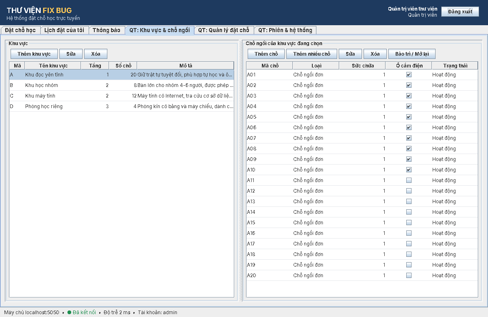 |
| Quản trị lượt đặt 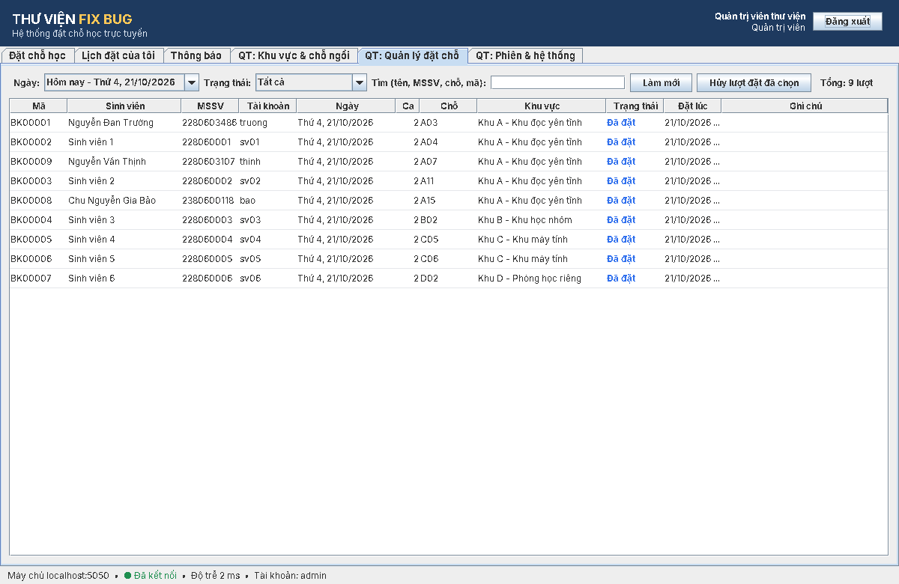 | Phiên đăng nhập & thống kê luồng 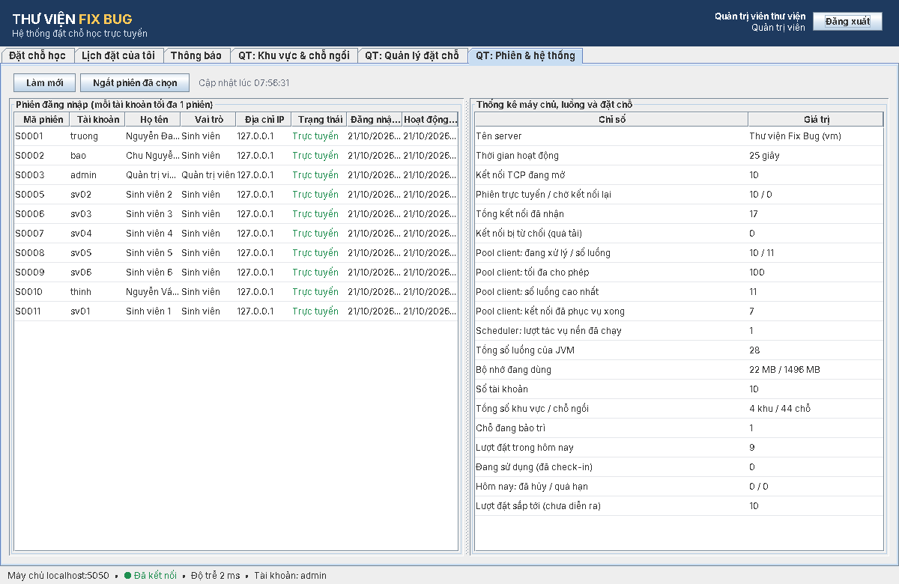 |
| Quản trị viên đặt hộ sinh viên tại quầy 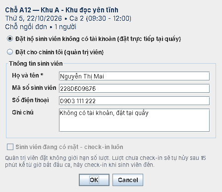 | Danh sách lượt đặt tại quầy 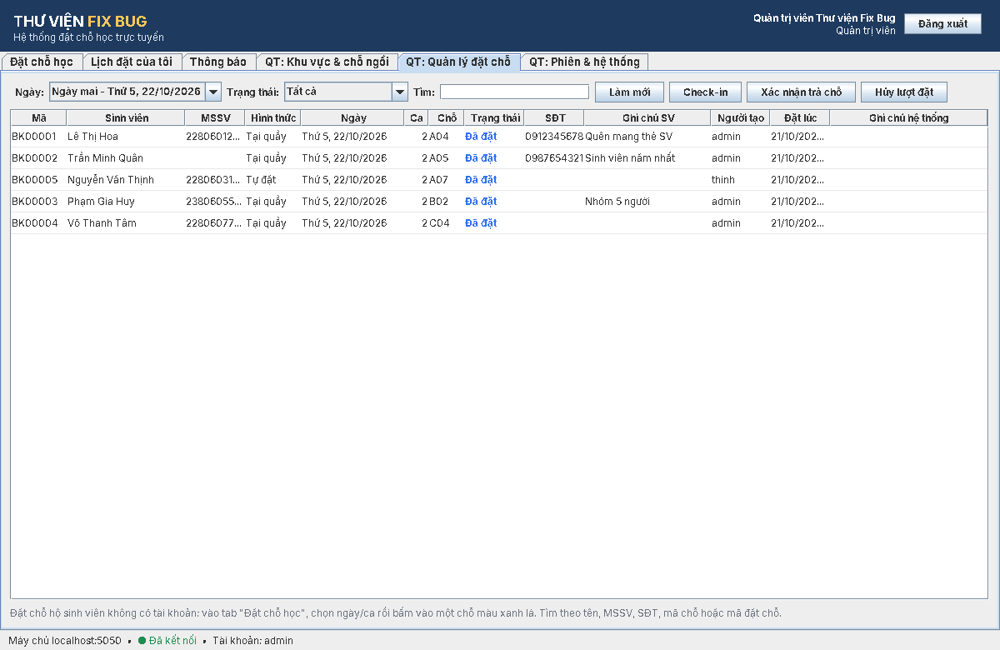 |
| Điểm uy tín của sinh viên 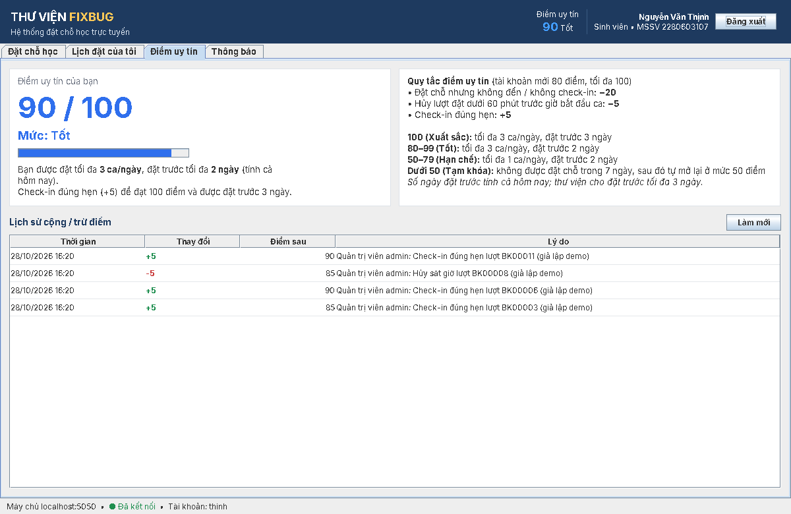 | Quản trị sinh viên & uy tín 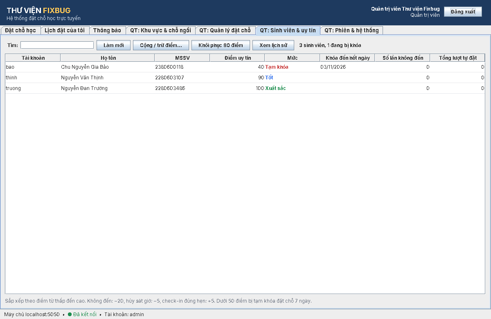 |
| Đặt lẻ / ngồi ghép khi khu đơn đã kín 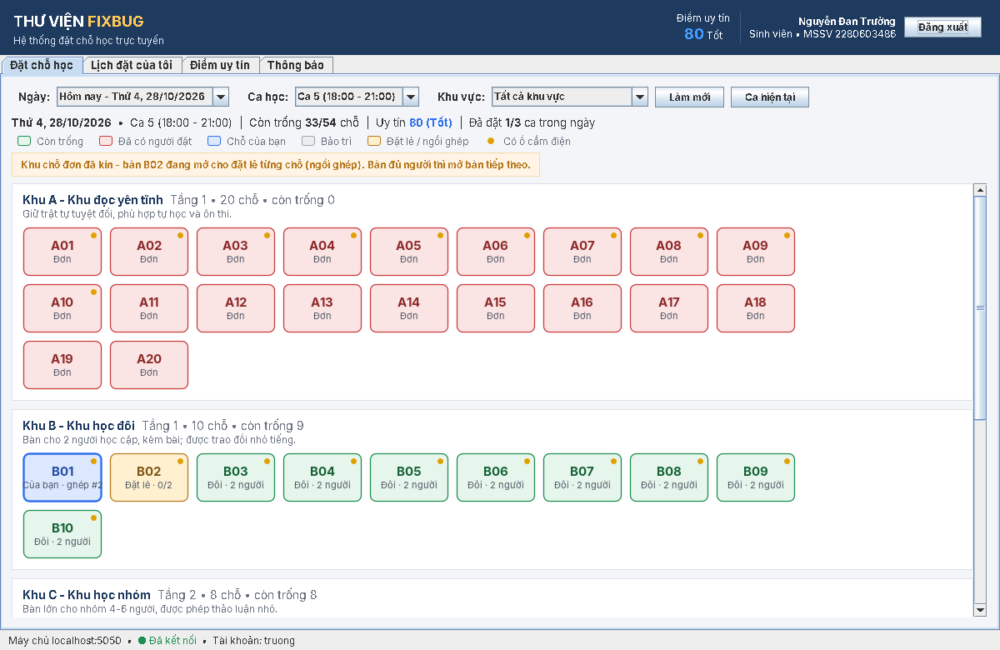 | |
